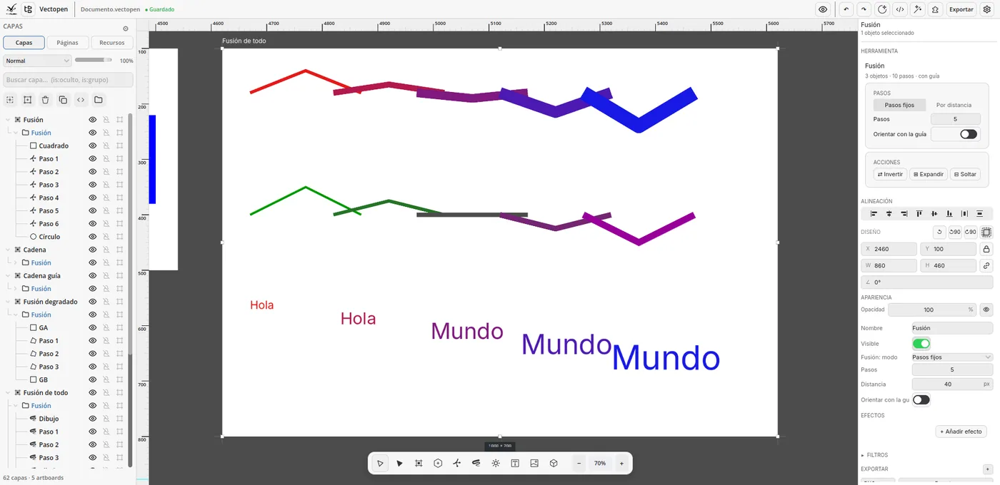

# Fusión (Blend)

Una **fusión** crea pasos intermedios entre dos o más objetos: interpola su **forma, color (también degradados), trazo y opacidad**.

## Crear una fusión

1. Selecciona dos o más objetos (el orden de la fusión es A → B → C).
2. Clic derecho ▸ **Crear fusión (Blend)**.

Para que los pasos sigan un camino, selecciona también un trazado y activa **Orientar con la guía** en el panel.

## Panel Fusión

Al seleccionar una fusión se abre su panel:

| Opción | Qué hace |
|---|---|
| **Pasos** | Número fijo de pasos, o **por distancia** entre ellos |
| **Orientar con la guía** | Gira cada paso según la dirección de la guía |
| **Invertir** | Cambia el orden de los extremos |
| **Expandir** | Convierte los pasos en objetos normales y editables |
| **Soltar** | Deshace la fusión y deja solo los objetos originales |

La fusión **no es destructiva**: si cambias un extremo (forma, color, posición), los pasos se recalculan solos.

## Qué se puede fusionar

- Figuras (rectángulos, elipses, polígonos, estrellas…).
- **Trazos de pincel**.
- Trazados **Bézier abiertos**.
- **Textos**: tamaño, color y posición.
