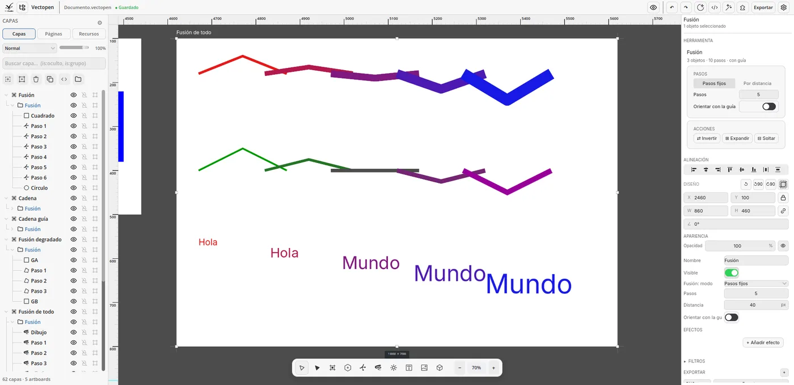

# Blend

A **blend** creates intermediate steps between two or more objects, interpolating their **shape, colour (gradients too), stroke and opacity**.

## Creating a blend

1. Select two or more objects (the blend order is A → B → C).
2. Right-click ▸ **Create blend**.

To make the steps follow a path, also select a path and turn on **Orient to guide** in the panel.

## Blend panel

Selecting a blend opens its panel:

| Option | What it does |
|---|---|
| **Steps** | A fixed number of steps, or **by distance** between them |
| **Orient to guide** | Rotates each step along the guide's direction |
| **Reverse** | Swaps the order of the ends |
| **Expand** | Turns the steps into normal, editable objects |
| **Release** | Removes the blend and leaves only the original objects |

A blend is **non-destructive**: change one end (shape, colour, position) and the steps are recalculated.

## What can be blended

- Shapes (rectangles, ellipses, polygons, stars…).
- **Brush strokes**.
- **Open Bézier paths**.
- **Text**: size, colour and position.
