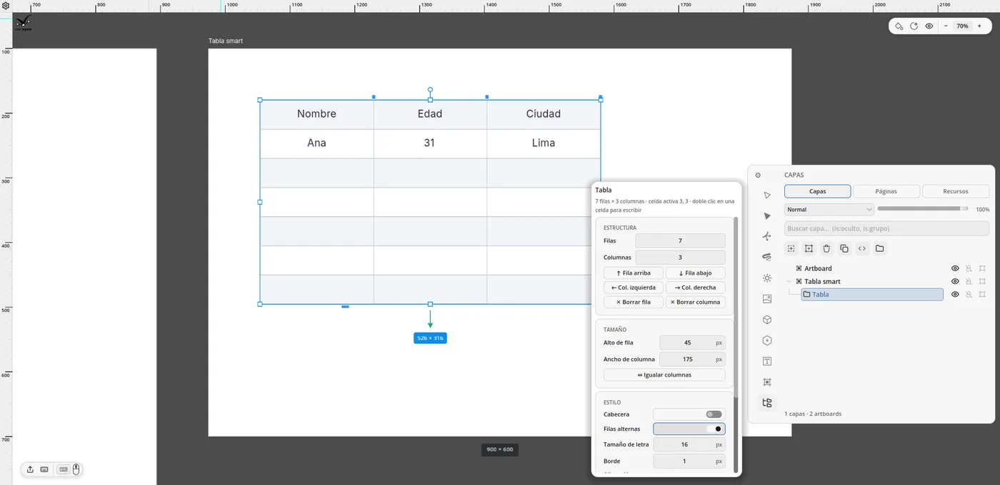
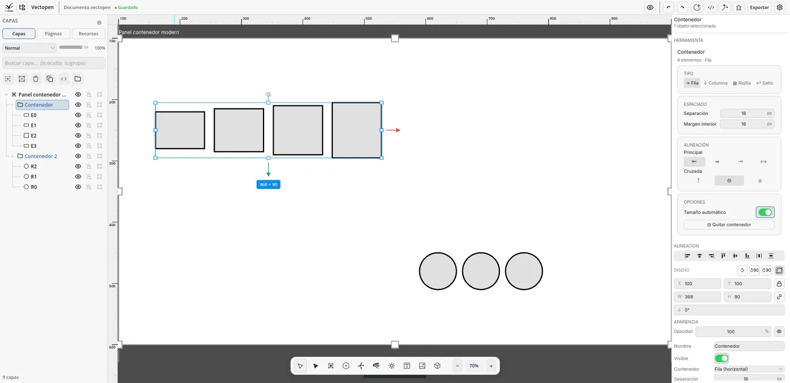

# Maquetación: tablas, contenedores y componentes

## Tablas

Clic derecho ▸ **Insertar tabla**. Una tabla se comporta como una tabla de verdad:

- **Un clic** selecciona la tabla entera (sin tiradores Bézier en su rejilla).
- **Doble clic en una celda**, también vacía, entra a escribir en ella. Esa celda queda como **celda activa**.
- En **Capas** la tabla es un solo objeto.

Al seleccionarla se abre el **panel Tabla**:

| Sección | Opciones |
|---|---|
| **Estructura** | Filas y columnas · insertar **fila arriba / abajo** y **columna a la izquierda / derecha** de la celda activa · borrar fila o columna |
| **Tamaño** | Alto de fila · ancho de la columna activa · **Igualar columnas** |
| **Estilo** | Cabecera · filas alternas · tamaño de letra · borde · alineación · colores |

Cada cambio es un solo paso de deshacer.

## Contenedores (Auto Layout)

Un **contenedor** coloca sus objetos automáticamente, como en Figma:

1. Selecciona los objetos.
2. Clic derecho ▸ **Convertir en contenedor (Auto Layout)**. El contenedor se crea en el mismo sitio.

En el **panel Contenedor**:

- **Flex**: en fila, en columna o con salto de línea.
- **Grid**: en rejilla.
- **Márgenes**, **hueco** entre objetos y **alineación**.

## Componentes

Un **componente** es un objeto reutilizable: todas sus copias son iguales y **editar una cambia las demás**.

- Crear: selecciona objetos y pulsa **+** en **Recursos ▸ Componentes** (o clic derecho ▸ **Crear componente vinculado**).
- En la lista: miniatura y número de copias. **Doble clic** coloca una copia; el clic derecho permite **seleccionar todas las copias**, **renombrar** y **desvincular**.
- Con **Sincronizar** apagado puedes hacer retoques locales en una copia.
- En **Capas**, las copias llevan un rombo.

## Páginas maestras

En el panel **Páginas**, marca **Esta página es maestra**. Lo que pongas en ella (cabecera, pie, número de página…) aparece debajo de las páginas que la usen. En cada página elige **Usar maestra**, o aplícala a **Todas las páginas**.

## Más herramientas de maquetación

- **Combinar datos (CSV)…** (clic derecho sobre un texto): crea una copia por fila de un CSV, para catálogos o tarjetas.
- **Insertar índice de páginas** (clic derecho en un espacio vacío).
- **Estilos de texto con nombre** (Título, Cuerpo, Pie…): fila **Estilo** en el panel de texto.
- **Colores globales** del documento: muestras con nombre en Recursos; al cambiar una cambian todos los objetos que la usan.
- **Imán a la retícula** de la página (márgenes y columnas).
