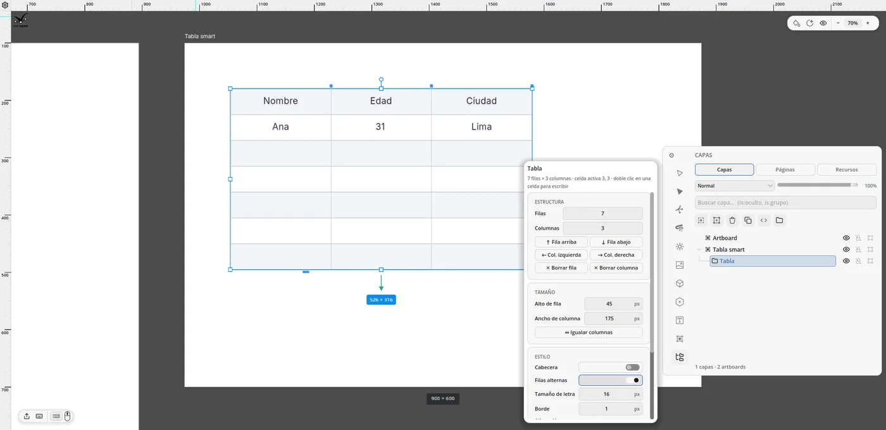
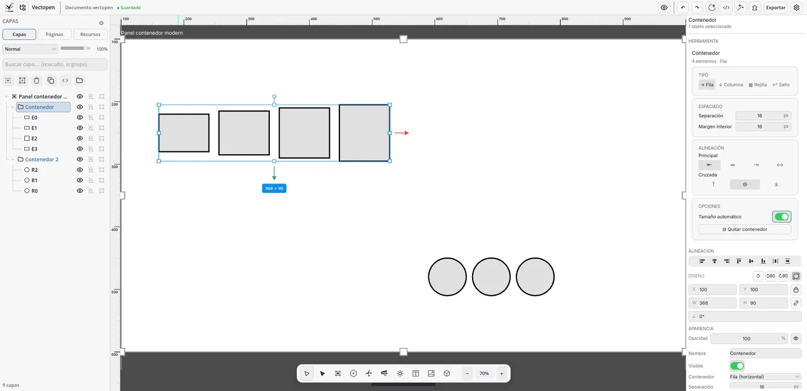

# Layout: tables, containers and components

## Tables

Right-click ▸ **Insert table**. A table behaves like a real table:

- **One click** selects the whole table (no Bézier handles on its grid).
- **Double-click a cell**, even an empty one, to type in it. That cell becomes the **active cell**.
- In **Layers**, the table is a single object.

Selecting it opens the **Table panel**:

| Section | Options |
|---|---|
| **Structure** | Rows and columns · insert a **row above / below** and a **column left / right** of the active cell · delete a row or column |
| **Size** | Row height · active column width · **Equal columns** |
| **Style** | Header · alternating rows · font size · border · alignment · colours |

Every change is a single undo step.

## Containers (Auto Layout)

A **container** places its objects automatically, as in Figma:

1. Select the objects.
2. Right-click ▸ **Convert to container (Auto Layout)**. The container is created in the same place.

In the **Container panel**:

- **Flex**: row, column or wrap.
- **Grid**: a grid layout.
- **Padding**, **gap** between objects and **alignment**.

## Components

A **component** is a reusable object: all its copies are the same and **editing one updates the rest**.

- Create: select objects and press **+** in **Resources ▸ Components** (or right-click ▸ **Create linked component**).
- In the list: thumbnail and copy count. **Double-click** places a copy; right-click lets you **select all copies**, **rename** and **detach**.
- With **Sync** off you can make local tweaks to one copy.
- In **Layers**, copies show a diamond.

## Master pages

In the **Pages** panel, tick **This page is a master**. Whatever you put on it (header, footer, page number…) shows under the pages that use it. On each page choose **Use master**, or apply it to **All pages**.

## More layout tools

- **Data merge (CSV)…** (right-click a text): makes one copy per CSV row, for catalogues or cards.
- **Insert table of contents** (right-click on empty space).
- **Named text styles** (Title, Body, Caption…): the **Style** row in the text panel.
- **Global document colours**: named swatches in Resources; changing one updates every object that uses it.
- **Snap to the page grid** (margins and columns).
