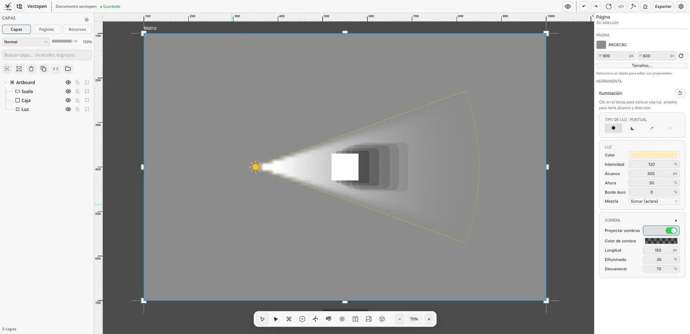

# Iluminación 2D

La herramienta **Luz** (en la barra de herramientas) añade luces que iluminan el dibujo y hacen que los objetos **proyecten sombras 2D en tiempo real**.

## Tipos de luz

| Tipo | Qué hace |
|---|---|
| **Puntual** | Ilumina en todas direcciones desde un punto, como una bombilla |
| **Foco** | Un cono de luz con dirección y apertura |
| **Direccional (sol)** | Rayos paralelos desde una dirección; la sombra no depende de la distancia |
| **Ambiente** | Luz de relleno sin dirección: aclara las sombras |

## Colocar y mover una luz

1. Elige la herramienta **Luz** y el tipo en el panel **Iluminación**.
2. Haz clic en la mesa de trabajo para colocarla.
3. Arrastra sus **tiradores** en el lienzo: **●** cambia el alcance y la dirección, **◆** la apertura del foco.

Todo cambia **en tiempo real**, también al escribir o arrastrar un número en el panel.

## Propiedades

| Propiedad | Efecto en la luz y en las sombras |
|---|---|
| **Intensidad** | Más luz y sombras más marcadas |
| **Color** | Tiñe la luz; la sombra toma el tono complementario |
| **Altura** | Una luz baja (rasante) da sombras largas; una luz alta, cortas |
| **Alcance** y **cono** | Hasta dónde llega la luz y su apertura (foco) |
| **Borde duro** | Sombras nítidas o suaves |

## Sombras

Dan sombra las **figuras**, los **textos y párrafos** (letra a letra), los **trazos de pincel** y los **trazados Bézier**. La sombra es la silueta del objeto, oscura junto a él y difuminándose hacia el final, siguiendo los rayos de la luz.

- Parámetros de la sombra: **color, longitud, difuminado y desvanecer**. **↺ Restablecer** vuelve a los valores de fábrica.
- Cada objeto tiene la opción **Proyectar sombra** para activarla o desactivarla.
- Funciona con fluidez con unas 500 figuras y 6 luces.
