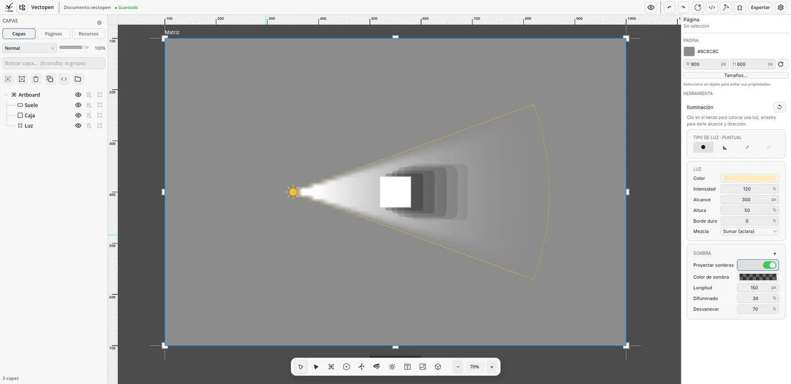

# 2D Lighting

The **Light** tool (in the toolbar) adds lights that illuminate the drawing and make objects **cast real-time 2D shadows**.

## Light types

| Type | What it does |
|---|---|
| **Point** | Lights in every direction from a point, like a bulb |
| **Spot** | A cone of light with a direction and angle |
| **Directional (sun)** | Parallel rays from one direction; the shadow does not depend on distance |
| **Ambient** | Fill light with no direction: it lightens the shadows |

## Placing and moving a light

1. Choose the **Light** tool and the type in the **Lighting** panel.
2. Click on the artboard to place it.
3. Drag its **handles** on the canvas: **●** changes range and direction, **◆** the spot angle.

Everything updates **in real time**, also while typing or dragging a number in the panel.

## Properties

| Property | Effect on the light and the shadows |
|---|---|
| **Intensity** | More light and stronger shadows |
| **Colour** | Tints the light; the shadow takes the complementary tint |
| **Height** | A low (grazing) light gives long shadows; a high one, short shadows |
| **Range** and **cone** | How far the light reaches and its angle (spot) |
| **Hard edge** | Crisp or soft shadows |

## Shadows

**Shapes**, **text and paragraphs** (letter by letter), **brush strokes** and **Bézier paths** cast shadows. The shadow is the object's silhouette, dark next to it and fading out towards the end, following the light rays.

- Shadow settings: **colour, length, blur and fade**. **↺ Reset** restores the defaults.
- Each object has a **Cast shadow** option to turn it on or off.
- It runs smoothly with about 500 shapes and 6 lights.
