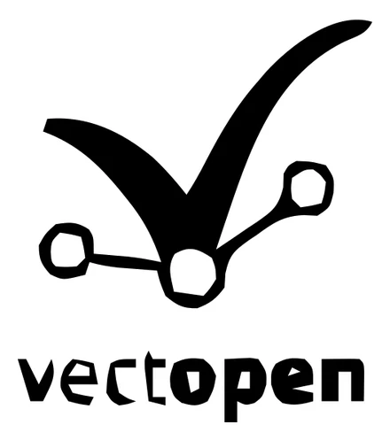
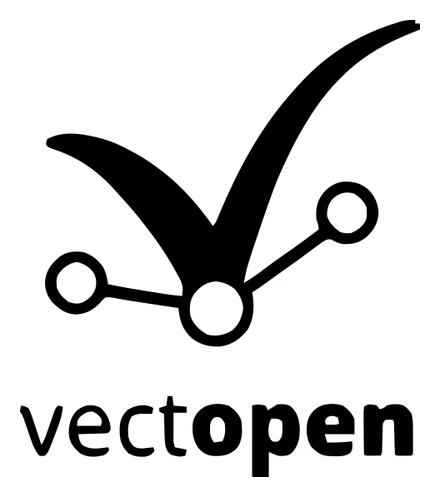

# Vectorize & AI image tools

**Vectorize** turns a bitmap image — a logo in PNG, an icon, a scanned drawing, a photo — into editable vector shapes. Two **AI tools** prepare the image first for a cleaner result: **Remove background** and **Upscale ×4**.

!!! success "Private and offline"
    Everything runs **on your computer**. The AI models are included inside Vectopen: nothing is uploaded, no internet connection or account is needed, and there are no usage limits.

!!! warning "Linux only in 0.2.0-alpha"
    Vectorize and the AI tools are in the **Linux** build. Windows and macOS support is planned.

## What it can do — a real example

A 96-pixel PNG logo, processed with Vectopen's own engine:

|  |  |  |
|:-:|:-:|:-:|
| **Original** — small and blurry | **Vectorized directly** — the circles come out angular | **Upscale ×4 (AI), then vectorized** — clean curves and text |

The result on the right is a real vector file: [download the SVG](../assets/vectorize/result.svg) and zoom in as much as you like.

## The three tools

| Tool | What it does | Engine |
|---|---|---|
| **Vectorize** | Traces the image into shapes: smooth Bézier curves, straight-sided polygons or square pixels | [VTracer](https://github.com/visioncortex/vtracer) (MIT) |
| **Remove background** · AI | Finds the subject and makes the background transparent | U²-Net (*u2netp*, Apache-2.0) |
| **Upscale ×4** · AI | Enlarges the image four times, recovering sharp edges | Real-ESRGAN General x4v3 (BSD-3-Clause) |

## How to use it

1. **Bring in an image:** use the Image tool, drag a file onto the canvas, or **paste** an image copied from a browser or a screenshot with **Ctrl+V**.
2. **Select the image.**
3. Open **Vectorize** — an inspector section in Modern, inside the Effects tab in Pro, the Effects window in Smart.
4. Choose a **preset** or adjust the options (below).
5. Optionally tick **Remove background first (AI)** and/or **Upscale ×4 first (AI)**.
6. Click **Vectorize**. Vectopen works in the background — the app stays responsive — and places the result as a **group of shapes** over the image, the same size.

Every step is one undo action: **Ctrl+Z** removes the result.

The two AI tools also work **on their own**: the **Remove background (AI)** and **Upscale ×4 (AI)** buttons change the selected image in place, without vectorizing it. After *Upscale ×4* the image keeps the same size on the canvas, but has four times the detail.

## Options

| Option | Meaning | Tip |
|---|---|---|
| **Preset** | *Logo / icon*, *Illustration*, *Photo (more detail)* | A good starting point; then fine-tune |
| **Paths** | **Bézier curves**, **Polygons** or **Pixels** | Curves for most work; Pixels for pixel art |
| **Detail** | Ignores specks smaller than N pixels | Raise it to remove noise; lower it to keep small details |
| **Colours** | Colour precision (1–8) | More = more colour layers and a heavier file |
| **Corners** | Angle above which a point becomes a sharp corner | Lower = more rounded; higher = sharper |
| **Black and white** | Black shapes on a transparent background | Logos, signatures, line art, stamps |
| **Remove background first (AI)** | Removes the background before tracing | Photos of objects, products, people |
| **Upscale ×4 first (AI)** | Enlarges before tracing | Small or blurry images (under ~300 px) |
| **Hide the original image** | Hides (doesn't delete) the image afterwards | Show it again from Layers |

## Getting the best quality

- **Best inputs:** logos, icons, line art, scans, signatures and **flat-colour** illustrations.
- **Small or blurry image?** Turn on **Upscale ×4 (AI)** — as in the example above, it's the biggest quality improvement.
- **Logo on a busy background?** **Remove background (AI)** first, then **Black and white** if the logo is one colour.
- **Photos and smooth gradients** are simplified into areas of flat colour (a "posterised" look). That's how tracing works; use *Photo (more detail)* and more **Colours** for a closer result, or keep the photo as an image.
- **Too many tiny shapes?** Raise **Detail**. **Lost small parts?** Lower it.
- **Text in the image** is traced as shapes, not editable text.

## Limits

- Very large images take longer; upscaling a big image ×4 creates a very large image. Upscale is meant for **small** images.
- Upscaling works in 128-pixel tiles; on large images faint seams can sometimes appear between tiles.
- Background removal works best when the subject is clear and in front; fine hair or transparent objects may be cut roughly.
