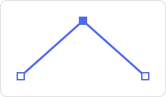
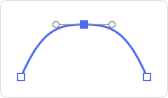
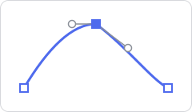
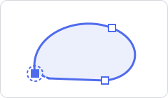

# Pen, Bézier & Node Editing

## Pen

A quick polyline tool: every click adds a straight point.

- **Left-click** — start a line, or add the next point.
- **Right-click** — finish the line. Switching tools also finishes it.

## Bézier (D)

The classic anchor-point pen:

1. **Click** to place a corner point.
2. **Click and drag** to place a smooth point with handles; the handles stay symmetric.
3. Hold **Alt** while dragging to move each handle independently.
4. Move near the **first point** — it highlights; click to close the shape.
5. **Enter** or **Escape** finishes an open path.

The result is an editable path: fill, stroke (including [gradients](../objects/color-gradients.md)), stroke width and open/closed are all in the inspector.

## Editing nodes

A path is made of **points** (anchors) joined by segments. Each point can have up to two **handles** that bend the segments on either side of it.

### Kinds of point

| | | |
|---|---|---|
|  | **Corner point** — no handles. The segments meet at an angle. | Bézier: a plain **click**. |
|  | **Smooth point** — two handles in a straight line. The curve passes through the point without a kink. | Bézier: **click and drag**. Node edit: **Alt + drag** from a corner point pulls handles out. |
|  | **Independent handles** — each side has its own angle and length, for a sharp but curved turn. | Bézier: hold **Alt** while dragging a handle. |
|  | **Closing a path** — the last segment returns to the first point. A closed path can be filled. | Bézier: move near the first point until it highlights, then click. |

### Using the Node edit tool

Select a path and choose the **Node edit** tool. Its points and handles appear.

| Action | How |
|---|---|
| Select a point | Click it · **Shift+click** adds or removes from the selection |
| Select all points | **A** |
| Move points | Drag them (all selected points move together) |
| Add a point | **Double-click** on the path — the new point gets short handles along the segment |
| Delete points | **X**, **Delete** or **Backspace** |
| Make a corner point smooth | **Alt + drag** from the point |
| Reshape a curve | Drag a handle |
| **Grab** mode | **G**, then move the mouse; **X** / **Y** lock to an axis; click or **Enter** to confirm, **Escape** to cancel |
| Back to Select | **Escape** |

Every edit is one undo step.

### What can be edited node by node

- **Paths** drawn with the Pen or Bézier tool.
- **Imported SVG** artwork — paths keep their real Bézier curves. (Shapes imported with a gradient fill become polygons whose curves are approximated by points; see [Importing SVG](../files/export-import.md#importing-svg-from-other-programs).)
- The result of **Convert to curves** — available in the Boolean section of the inspector (Modern), the top bar (Pro) and the right-click menu. It turns a **boolean** object, or **two or more selected shapes** (merged together), into one editable path.

**Primitive shapes** — rectangle, ellipse, polygon, star, drop and the custom shapes — are edited through their parameters (corner radius, number of points…), not point by point. A single primitive shape can't be converted to a path yet.
