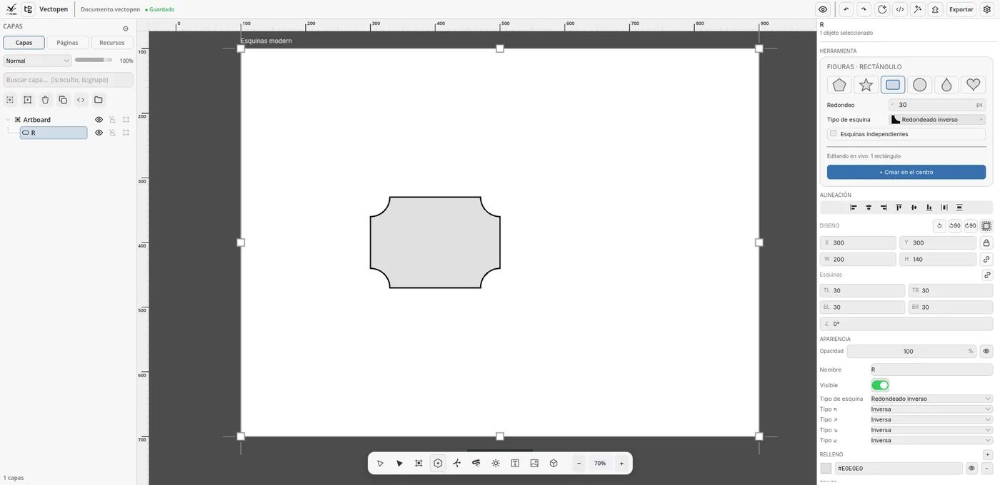

# Formas

Pulsa el botón de **formas** para abrir el panel de formas y elegir qué dibujar. Tiene seis tipos:

| Tipo | Opciones |
|---|---|
| **Polígono** | Polígono regular desde 3 lados; preajustes de triángulo, pentágono, hexágono… |
| **Estrella** | Número de puntas, profundidad y redondeo |
| **Rectángulo** | Rectángulo o cuadrado con esquinas redondeadas |
| **Elipse** | Elipse, anillo, tarta o arco |
| **Gota** | Gota / lágrima |
| **Formas** | Formas listas: **corazón, flechas, cruz, luna, rayo, bocadillo, nube** |

## Dibujar

1. Elige una forma en el panel.
2. Haz clic y arrastra sobre la mesa de trabajo. Los arrastres de menos de unos 3 px se ignoran.

| Tecla al arrastrar | Efecto |
|---|---|
| **Mayús** | Mantiene las proporciones (cuadrado, círculo, estrella regular) |
| **Alt** | Dibuja desde el centro hacia fuera |

También puedes insertar una forma en el centro de la mesa de trabajo directamente desde el panel, y luego colocarla.

## Editar

Cualquier forma se puede mover, **redimensionar arrastrando sus tiradores** y girar con la herramienta Selección — estrellas y formas personalizadas incluidas. En el inspector puedes cambiar:

- posición, tamaño, giro y opacidad;
- relleno y trazo (color o [degradado](../objects/color-gradients.md)), grosor y estilo del trazo;
- **rectángulos:** radio de las esquinas, igual para todas o cada una por separado;
- **elipses:** elipse completa, arco o tarta (ángulo inicial/final, radio interior para anillos);
- **polígonos y estrellas:** número de lados o puntas, radio interior.

Las formas primitivas se editan con estos parámetros, no punto a punto — ver [qué se puede editar punto a punto](pen-bezier.md#que-se-puede-editar-punto-a-punto). Para editar una forma punto a punto, conviértela antes (abajo).

## Esquinas avanzadas

Cada esquina de un rectángulo puede tener su propio estilo: **redonda**, **redondeado inverso**, **chaflán**, **muesca**, **zigzag** o **dientes de sierra**. Elígelo en el panel **Figuras**, o mantén **Mayús** y haz clic en un tirador de redondeo del lienzo para ir pasando de un estilo a otro.

## Convertir en trazado Bézier

Clic derecho sobre una forma ▸ **Convertir en trazado Bézier**. Polígonos, rectángulos, estrellas y elipses pasan a un trazado editable con la misma forma, relleno, trazo y posición (los lados rectos quedan exactos; las curvas, con pocos nodos con tiradores). El editor de nodos se abre solo. Se deshace con un solo Ctrl+Z.

## Grosor con Mayús + arrastrar

Con una forma seleccionada y la herramienta de formas, Bézier, pluma o nodos activa, mantén **Mayús** y arrastra **sobre la forma** para cambiar el grosor del trazo en vivo: arriba o derecha = más grueso, abajo o izquierda = más fino. Una etiqueta junto al cursor muestra el grosor. Mayús + arrastrar fuera de la selección sigue dibujando una forma proporcional.
