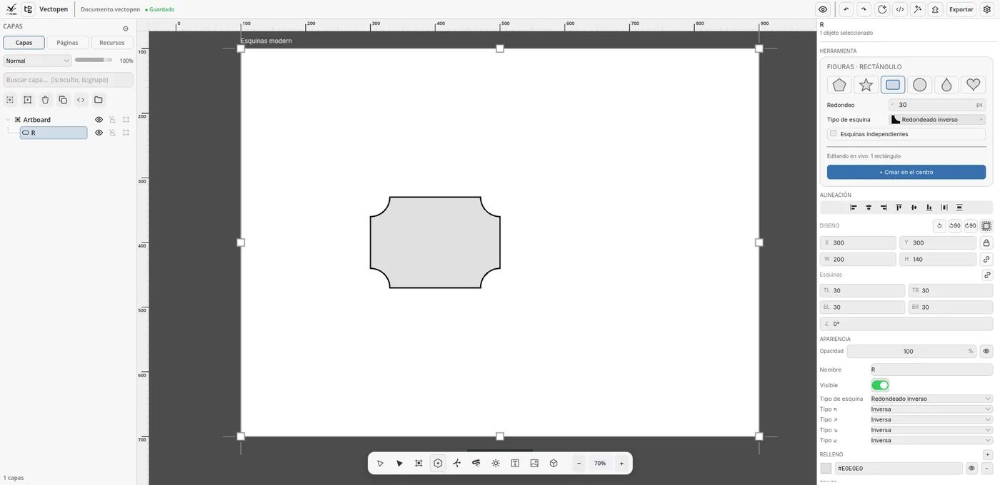

# Shapes

Click the **shapes** button to open the shape panel and pick what to draw. It has six kinds:

| Kind | Options |
|---|---|
| **Polygon** | Regular polygon from 3 sides up; presets for triangle, pentagon, hexagon… |
| **Star** | Number of points, depth and rounding |
| **Rectangle** | Rectangle or square with rounded corners |
| **Ellipse** | Ellipse, ring, pie or arc |
| **Drop** | Drop / teardrop |
| **Shapes** | Ready-made shapes: **heart, arrows, cross, moon, bolt, speech bubble, cloud** |

## Drawing

1. Pick a shape in the panel.
2. Click and drag on the artboard. Drags shorter than about 3 px are ignored.

| Key while dragging | Effect |
|---|---|
| **Shift** | Keep proportions (square, circle, regular star) |
| **Alt** | Draw from the centre outwards |

You can also insert a shape at the centre of the artboard straight from the panel, and then move it into place.

## Editing

Every shape can be moved, **resized by dragging its handles** and rotated with the Select tool — stars and custom shapes included. In the inspector you can change:

- position, size, rotation and opacity;
- fill and stroke (colour or [gradient](../objects/color-gradients.md)), stroke width and style;
- **rectangles:** corner radius, the same for all corners or each one separately;
- **ellipses:** full ellipse, arc or pie (start/end angle, inner radius for rings);
- **polygons and stars:** number of sides or points, inner radius.

Primitive shapes are edited through these parameters, not point by point — see [what can be edited node by node](pen-bezier.md#what-can-be-edited-node-by-node). To edit a shape node by node, convert it first (below).

## Advanced corners

Each corner of a rectangle can have its own style: **round**, **inverted round**, **chamfer**, **notch**, **zigzag** or **saw-tooth**. Choose it in the **Shapes** panel, or hold **Shift** and click a corner-radius handle on the canvas to cycle through the styles.

## Convert to Bézier path

Right-click a shape ▸ **Convert to Bézier path**. Polygons, rectangles, stars and ellipses become an editable path with the same shape, fill, stroke and position (straight sides stay exact; curves get few nodes with handles). The node editor opens straight away. It is a single undo step.

## Stroke width with Shift + drag

With a shape selected and the shape, Bézier, pen or node tool active, hold **Shift** and drag **over the shape** to change its stroke width live: up or right = thicker, down or left = thinner. A label next to the cursor shows the width. Shift + drag outside the selection still draws a proportional shape.
