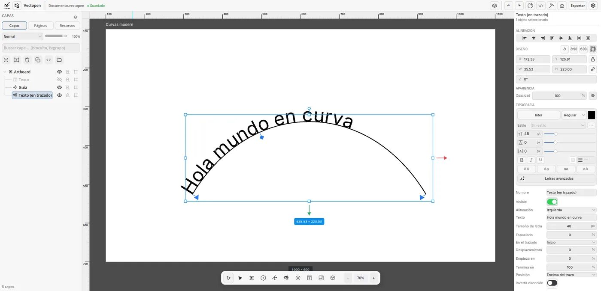

# Texto

## Crear texto

- **Texto de punto:** con la herramienta Texto (**T**), haz clic en la mesa de trabajo y escribe. La caja crece con el texto.
- **Texto de párrafo:** con la herramienta Párrafo (**P**), arrastra un marco. El texto se ajusta dentro del marco, y los marcos se pueden **enlazar** para que el texto pase de uno a otro.
- **Doble clic** en un texto para editarlo. Haz clic fuera para terminar; vuelves a la herramienta Selección con el texto seleccionado.

Mantén **Ctrl** (**Cmd** en macOS) y arrastra en vertical sobre un texto para cambiar su tamaño de forma interactiva.

## Tipografía

Con un texto seleccionado, los controles de tipografía están en el inspector (Modern), en la pestaña **Texto** (Pro) o en el panel de texto (Smart):

- familia de fuente (incluidas **Google Fonts**), peso y estilo;
- tamaño, interlineado, espaciado entre letras;
- negrita, cursiva, subrayado; mayúsculas (MAYÚSCULAS, Título, minúsculas);
- alineación, color del texto (sólido o degradado) y trazo;
- **letras avanzadas** — estilos y efectos por letra.

**Ctrl+Alt+.** y **Ctrl+Alt+,** hacen el texto seleccionado más grueso o más fino.

## Texto en trazado

Selecciona un texto y un trazado y haz clic derecho ▸ **Texto en trazado**. Las letras se apoyan en su línea base real y no se deforman con la curva.

- Tiradores en el lienzo: **▶** dónde empieza el texto, **◀** dónde termina y **◆** lo desliza a lo largo de la curva.
- **Encima, debajo o centrado** en el trazado, **invertir la dirección** y **espejo**.
- El texto en trazado queda encima de su guía: **un clic en cualquier letra** lo selecciona y se arrastra como cualquier objeto.
- Clic derecho ▸ **Separar texto del trazado** recupera el texto original.

## Estilos de texto

Los estilos con nombre (Título, Cuerpo, Pie…) están en la fila **Estilo** del panel de texto. Redefinir un estilo actualiza todos los textos que lo usan, respetando los retoques. Al editar, el formato también se puede aplicar **solo a las letras seleccionadas**.

## Texto a curvas

Clic derecho ▸ **Convertir a curvas (Bézier)** (**Ctrl+Mayús+O**) convierte un texto en un trazado Bézier por letra; un doble clic en una letra edita sus nodos.

## Efectos de texto

Las sombras, contornos, 3D y demás [efectos](../objects/effects-filters-shaders.md) también funcionan con texto. Al exportar a SVG puedes convertir el texto en curvas, para que se vea bien aunque la fuente no esté instalada.

## Rendimiento

El texto se dibuja como contornos vectoriales nítidos al acercar el zoom, y el texto fuera de pantalla no se dibuja, así que los documentos con cientos de textos siguen siendo rápidos.
