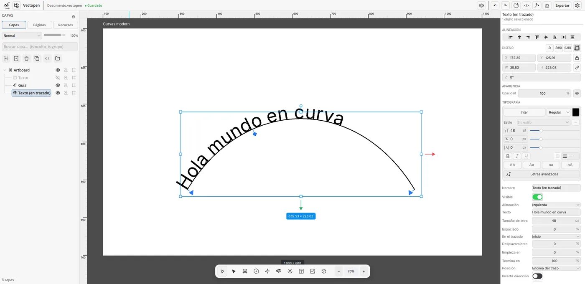

# Text

## Creating text

- **Point text:** with the Text tool (**T**), click on the artboard and type. The box grows with the text.
- **Paragraph text:** with the Paragraph tool (**P**), drag a frame. Text wraps inside the frame, and frames can be **linked** so text flows from one to the next.
- **Double-click** a text to edit it. Click outside to finish; you're returned to the Select tool with the text selected.

Hold **Ctrl** (**Cmd** on macOS) and drag vertically on a text to scale its size interactively.

## Typography

With a text selected, the typography controls are in the inspector (Modern), in the **Text** tab (Pro) or in the text panel (Smart):

- font family (including **Google Fonts**), weight and style;
- size, line spacing, letter spacing;
- bold, italic, underline; case (UPPER, Title, lower);
- alignment, text colour (solid or gradient) and stroke;
- **advanced letters** — styles and effects per letter.

**Ctrl+Alt+.** and **Ctrl+Alt+,** make the selected text heavier or lighter.

## Text on a path

Select a text and a path, then right-click ▸ **Text on path**. The letters sit on their real baseline and do not distort with the curve.

- On-canvas handles: **▶** where the text starts, **◀** where it ends, **◆** slides it along the curve.
- **Above, below or centred** on the path, **reverse direction** and **mirror**.
- The text-on-path object sits above its guide: **one click on any letter** selects it and you can drag it like any object.
- Right-click ▸ **Detach text from path** brings back the original text.

## Text styles

Named styles (Title, Body, Caption…) are in the **Style** row of the text panel. Redefining a style updates every text that uses it, keeping local tweaks. Formatting can also apply to **just the selected letters** while editing.

## Text to curves

Right-click ▸ **Convert to curves (Bézier)** (**Ctrl+Shift+O**) turns a text into one Bézier path per letter; a double-click on a letter edits its nodes.

## Text effects

Shadows, outlines, 3D and the other [effects](../objects/effects-filters-shaders.md) work on text too. When exporting to SVG you can convert text to curves, so it looks right even where the font isn't installed.

## Performance

Text is drawn as crisp vector outlines when you zoom in, and off-screen text is skipped, so documents with hundreds of text blocks stay fast.
